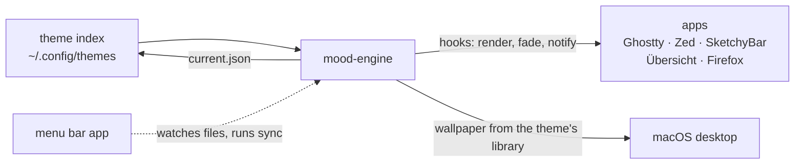

# mood-engine

**A theming app for macOS, with a wallpaper finder built in.** One Base24 theme index
drives your terminal, editor, menu bar, widget stack, browser and wallpaper — with live
colour fades where the app allows it.

mood-engine is built around the theme, not around the wallpaper. You curate a theme index
once; mood-engine applies that theme to the apps that can follow it live, and to the ones
that need a file, a signal or a notification. The desktop wallpaper is one of the things
the theme controls, so mood-engine also finds an existing image that fits — instead of
recolouring one.

## What it is, and what it isn't

- **It is a theme engine.** `~/.config/themes` is the source of truth: a Base24 palette
  plus semantic roles. `mood-engine use` changes the global selection; `mood-engine sync`
  pushes it to the desktop and to every configured app hook. Apps that implement the
  theme-index reader follow along by themselves.
- **It is not a wallpaper-first app.** Wallpaper discovery is a supporting feature, not
  the product. The gallery and library exist because a theme includes a desktop
  background; they let that background keep up with the theme instead of forcing you to
  recolour an image to match it.
- **Why that ordering matters.** Wallpaper-first tools start from an image: pywal,
  wallust and matugen extract a palette from it; lutgen and gowall recolour it to a
  palette. mood-engine starts from curated theme data and applies that everywhere,
  wallpaper included. The theme is the input; the apps and the desktop are the output.

## What it does

1. **Applies the theme.** Resolves the active theme from the Base24 index and writes the
   global selection, atomically. macOS dark/light, `current.json` written by another app,
   and the daily wallpaper rotation all resolve through the same choice.
2. **Keeps apps in line.** Hooks render tinted-theming templates into app theme files,
   step a file through in-between themes for a fade, glide a terminal's ANSI colours with
   OSC sequences, or hand the theme to a native app through JSON and a Darwin
   notification. This is the core of the app: one theme, many apps.
3. **Finds a wallpaper for the theme.** Asks Wallhaven, Unsplash and Pexels for
   candidates using each API's colour filter, scores every thumbnail in OKLab against the
   theme, and shows a ranked gallery styled in that theme. Save the ones you like;
   mood-engine rotates them daily or pins one.
4. **Keeps the desktop in sync.** The menu bar app re-applies the theme and wallpaper on
   appearance flips, theme edits, wake, and day changes.



## Quick start

Requires [uv](https://docs.astral.sh/uv/) and Python ≥ 3.11 (uv fetches one if needed).
The menu bar app needs macOS 14+ and Xcode or the Command Line Tools.

```bash
git clone https://github.com/paraversal/mood-engine.git
cd mood-engine
uv sync
uv run mood-engine themes                 # list themes; * = what "system" resolves to
uv run mood-engine use firebox            # theme the apps and the desktop
uv run mood-engine                        # gallery: find a wallpaper for the theme
./macos/build.sh --install                # menu bar app (optional)
```

`uv tool install -e .` puts `mood-engine` on your `PATH`.

## Supported apps

The integrations fall into five shapes. The full setup for each, including the exact
hooks and app configs, is in the [guide](docs/GUIDE.md#app-support).

| Shape | How the app gets the theme | Tested with |
|-------|----------------------------|-------------|
| **Watches a file** | Hook renders the app's theme file; the app re-reads it. `fade` steps it through in-between themes. | Zed |
| **Reloads on a signal** | Hook renders the theme file, glides the terminal's colours with OSC, then sends the reload signal. | Ghostty |
| **Reads the theme index** | The app implements the reader protocol itself; a hook can trigger an instant refresh. | SketchyBar, Übersicht Dailies |
| **Needs a reload command** | Hook renders the file, then runs an AppleScript/CLI command to make the app re-read it. | Übersicht fs-health, job-overview |
| **Can't read the index** | JSON or CSS plus a Darwin notification; a native host streams it to a browser extension. | Firefox + Sidebery, native apps |

The ready-made hooks are:

| Preset | What it does |
|--------|--------------|
| `ghostty` | Writes `~/.config/ghostty/themes/mood-engine` and fades open terminals. |
| `zed` | Writes `~/.config/zed/themes/mood-engine.json` with an 800 ms stepped fade. |
| `css` | Writes `--theme-*` CSS custom properties for a web UI or widget. |
| `json` | Writes the theme as JSON and posts `local.mood-engine.theme` after every write, fade frames included. |

`mood-engine hooks --presets` prints the exact app-side line each one needs. The
theme-index protocol is documented in the `themes` Claude skill
(`~/.claude/skills/themes/SKILL.md`, kept with the theme index in the dotfiles `themes`
package). That skill has been used to implement mood-engine support in apps; for a new
integration, follow it for the app-side reader, then add a hook here for the push side.

## How a switch works

1. `mood-engine use THEME` writes the id into
   `~/.local/state/themes/current.json` under its variant, atomically.
2. It runs the hooks, so apps render the new theme, fade into it, or receive a
   notification. Apps that follow the index with live reload pick it up on their own.
3. It also picks the theme's wallpaper from the library — the pin, or today's pick from
   the daily rotation — and sets it in the background, so no fade waits on the desktop.
   The wallpaper is part of the theme, not a separate pipeline.
4. The menu bar app repeats the same sync when macOS flips dark/light, when a theme file
   or `current.json` changes, when you wake the Mac, and when the day changes.

After a dark/light flip the app holds the wallpaper back for a second while macOS
redraws, so the menu bar doesn't go blank; hooks still start immediately.

## Repository layout

```
src/mood_engine/              CLI, theme reader, scoring, sources, library, server, sync/hooks
src/mood_engine/templates/    built-in templates: Ghostty, Zed, CSS, theme JSON
macos/                        native menu bar app (Swift, AppKit)
tests/                        pytest suite
docs/GUIDE.md                 setup, usage, theming hooks, app support, wallpaper search
```

## Documentation

- [Setup and usage guide](docs/GUIDE.md) — install, theme index, commands, menu bar app,
  hooks and presets, app integrations, wallpaper gallery and library, scoring.
- [Hook example](src/mood_engine/templates/hooks.example.toml) — every key, commented.
- `mood-engine-firefox` — companion repository with the Firefox native host,
  WebExtension and Sidebery integration.

## Development

```bash
uv run pytest -q            # test suite
./macos/build.sh            # build the menu bar app
./macos/build.sh --install  # build, copy to ~/Applications and start it
```

The tests use synthetic images and embedded schemes, so they need neither
`~/.config/themes` nor network access. See the [guide](docs/GUIDE.md#development) for
what they cover.

## Requirements and limits

- macOS for wallpaper setting and the menu bar app; the search, rendering and local
  gallery also work elsewhere.
- Wallpaper setting changes only the current Space of each screen; other Spaces keep
  their wallpaper until you apply again while they are active.
- Results depend on the APIs' colour filters; Wallhaven's filter only requires the colour
  to appear somewhere, so the ranking does the real work.
- The menu bar app is ad-hoc signed, so macOS may ask for Automation permission again
  after a rebuild.
