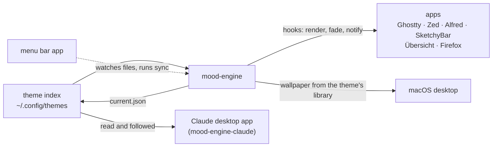

# mood-engine

**A theming app for macOS, with a wallpaper finder built in.** One Base24 theme index
drives your terminal, editor, launcher, menu bar, desktop widgets, browser and wallpaper,
with colour fades where the app allows it.

You keep a set of themes in `~/.config/themes`. mood-engine applies the active one to
every app it can reach: some follow the index themselves, others get a rendered theme
file, a reload signal or a notification. The wallpaper is part of the theme too, so
mood-engine finds existing images that match it and rotates them. Tools like pywal,
wallust and matugen go the other way and derive a palette from an image.

## What it does

1. **Applies the theme.** `mood-engine use THEME` sets the global selection. macOS
   switching dark/light, another app writing `current.json` and the daily wallpaper
   rotation all go through the same choice.
2. **Keeps apps in line.** Hooks render [tinted-theming](https://github.com/tinted-theming/home)
   templates into app theme files, step a file through in-between themes for a fade,
   glide a terminal's colours with OSC sequences, or hand the theme to a native app as
   JSON plus a Darwin notification.
3. **Finds wallpapers for the theme.** It asks Wallhaven, Unsplash and Pexels for
   candidates with each API's colour filter, scores every thumbnail against the theme in
   OKLab, and shows a ranked gallery. Saved wallpapers rotate daily, or you pin one.
4. **Keeps the desktop in sync.** A small menu bar app re-applies the theme and wallpaper
   when macOS flips dark/light, a theme file changes, the Mac wakes, or the day changes.



## Quick start

Requires [uv](https://docs.astral.sh/uv/) and Python ≥ 3.11 (uv fetches one if needed).
The menu bar app needs macOS 14+ and Xcode or the Command Line Tools.

```bash
git clone https://github.com/paraversal/mood-engine.git
cd mood-engine
uv sync
uv run mood-engine themes                 # list themes; * = what "system" resolves to
uv run mood-engine use firebox            # theme the apps and the desktop
uv run mood-engine                        # gallery: find a wallpaper for the theme
./macos/build.sh --install                # menu bar app (optional)
```

`uv tool install -e .` puts `mood-engine` on your `PATH`. The [guide](docs/GUIDE.md)
covers the theme index format, hooks and every integration.

## Supported apps

| App | How it gets the theme | Setup |
|-----|-----------------------|-------|
| Ghostty | Theme file; open terminals glide to the new colours, then Ghostty reloads | `preset = "ghostty"` |
| Zed | Theme file that Zed re-reads by itself, stepped through in-between themes | `preset = "zed"` |
| Alfred | Theme file in Alfred's preferences; the hook makes Alfred re-read it | `preset = "alfred"` |
| SketchyBar | The bar's config reads the theme index; a hook triggers the switch | a `run` hook |
| Übersicht widgets: [Dailies](https://github.com/paraversal/uebersicht-dailies), [job-overview](https://github.com/paraversal/uebersicht-job-overview) | Each widget reads the theme index; a hook reloads it | a `run` hook per widget |
| Claude desktop and mobile apps | A [Claude Code mod](https://github.com/paraversal/mood-engine-claude) reads the theme index and paints the app, dark and light halves at once | install the mod; no hook |
| Firefox and Sidebery | A native messaging host streams the theme JSON to a WebExtension | `preset = "json"` plus a bridge (tested with one that isn't public yet) |
| Native apps, scripts | Theme JSON plus a Darwin notification after every write | `preset = "json"` |
| Web pages, Electron, Tauri | `--theme-*` CSS custom properties | `preset = "css"` |

Each preset is a ready-made hook; `mood-engine hooks --presets` prints what it stands
for and the line the app's own config needs. The [app support](docs/GUIDE.md#app-support)
section of the guide has the full setup for each one.

For an app that should read the theme index itself, the reader protocol (file formats,
role contract, theme choice, live reload, fades, platform notes) is in
[`skills/themes/SKILL.md`](skills/themes/SKILL.md). It is written as a Claude skill, so
it can also be linked into `~/.claude/skills/themes/`.

## How a switch works

1. `mood-engine use THEME` writes the id into `~/.local/state/themes/current.json` under
   its variant, atomically.
2. It runs the hooks, so apps render the new theme, fade into it or get notified. Apps
   that follow the index with live reload pick it up on their own.
3. It sets the theme's wallpaper from the library (the pin, or today's pick) while the
   hooks run, so no fade waits on the desktop.
4. The menu bar app runs the same sync when macOS flips dark/light, when a theme file or
   `current.json` changes, when the Mac wakes, and when the day changes.

## Repository layout

```
src/mood_engine/              CLI, theme reader, scoring, sources, library, server, sync/hooks
src/mood_engine/templates/    built-in templates: Ghostty, Zed, Alfred, CSS, theme JSON
macos/                        native menu bar app (Swift, AppKit)
skills/themes/SKILL.md        the theme-index reader protocol, for apps (and Claude)
tests/                        pytest suite
docs/GUIDE.md                 setup, usage, hooks, app support, wallpapers, scoring
```

## Documentation

- [Guide](docs/GUIDE.md): install, theme index, commands, menu bar app, hooks and
  presets, app integrations, wallpaper gallery and library, scoring.
- [Theme-index protocol](skills/themes/SKILL.md): how an app reads and follows the index.
- [Hook example](src/mood_engine/templates/hooks.example.toml): every key, commented.

## Development

```bash
uv run pytest -q            # test suite
./macos/build.sh            # build the menu bar app
./macos/build.sh --install  # build, copy to ~/Applications and start it
```

The tests use synthetic images and embedded schemes, so they need neither
`~/.config/themes` nor network access.

## Requirements and limits

- macOS for setting the wallpaper and for the menu bar app; search, rendering and the
  local gallery also work elsewhere.
- macOS sets the wallpaper only on the current Space of each screen; other Spaces keep
  theirs until you apply again while they are active.
- Results depend on the APIs' colour filters. Wallhaven's filter only requires the colour
  to appear somewhere, so the ranking does the real work.
- The menu bar app is ad-hoc signed, so macOS may ask for Automation permission again
  after a rebuild.

## License

GPL-3.0-only. See [LICENSE](LICENSE).
